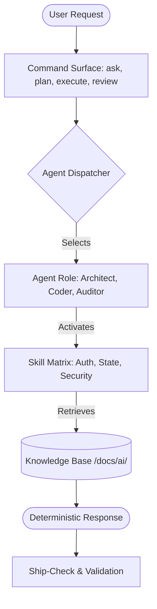

# 🎯 Flutter Prompt Operating System (FPOS)

### *The Deterministic Engine for Enterprise-Grade Flutter Development*

[](https://opensource.org/licenses/MIT)
[](https://github.com/DNY000/flutter_prompts)
[](docs/ai/core/system/runtime-rules.md)

---

## 📖 1. Overview & Vision

**Flutter Prompt Operating System (FPOS)** is not a template or a collection of static prompts. It is a **Deterministic Agentic Environment** designed to bridge the gap between AI code generation and enterprise-grade engineering discipline.

By transforming AI (Cursor, Claude, GPT) into a **Senior Lead Flutter Architect**, FPOS enforces a "Digital Iron Discipline" across your codebase. It ensures that every line of code meets strict mandates for:
- 🛡️ **Hardened Security**: Mandatory PKCE, SSL Pinning, and Biometric standards.
- 🏗️ **Architectural Integrity**: Domain-driven layering with mandatory hydrated persistence.
- ⚡ **Performance Excellence**: Pre-optimized for the Impeller engine and Wasm/Web runtime.
- 🤖 **Zero-Hallucination Logic**: Every AI response is grounded in the project's local knowledge base (`docs/ai/`).

---

## 🏗️ 2. System Architecture

FPOS operates on a modular **Command → Agent → Skill → Context** pipeline, ensuring that the AI has precisely the right knowledge at the right time.



---

## ⚙️ 3. One-Click Installation

You do not need to clone this repository manually. Run the following command at the root of your Flutter project to "inject" the FPOS brain:

```bash
curl -fsSL https://raw.githubusercontent.com/DNY000/flutter_prompts/main/install.sh | bash
```

**What happens next?**
1.  **Context Injection**: The `docs/` knowledge base is copied locally.
2.  **Rule Enforcement**: `.cursor/rules/` are configured for Cursor IDE.
3.  **Manual Ingestion Surface**: `manual-prompt-bundle.md` mirrors the canonical mobile-first rules for tools without retrieval.

---

## 🛠️ 4. Developer Tools (The Engine Room)

The `tools/` directory contains the high-performance infrastructure that powers the OS:

*   **Prompt CLI (PowerShell/NodeJS)**: Located at `tools/prompt-powershell/`, with root wrapper `prompt-cli.ps1` for command-driven prompt generation.
*   **Intelligent Routing**: Automatically resolves the best "Knowledge Path" for any query.
*   **Validation Runtime**: Located at `tools/prompt-runtime-typescript/`, ensuring catalog consistency and contract compliance.
*   **Prompt Bundler**: Merges core logic into optimized ingestion packages such as standard, compact, detailed, and minimal variants.

---

## 🤖 5. Agentic Command Matrix

FPOS supports a standardized command surface to guide the AI lifecycle:

| Command | Goal | Default Agent |
| :--- | :--- | :--- |
| `ask` | Research & Framing | Research Analyst |
| `plan` | Roadmap & Sequencing | Lead Architect |
| `execute` | Implementation & Tests | Senior Coder |
| `review` | Audit & Triage | Security/Performance Auditor |
| `ship-check` | Release Readiness | QA Engineer |

---

## 📂 6. Knowledge Inventory

The "Brain" of the system is stored in hierarchical guide packs:
- **Core Architecture**: `docs/ai/core/`
- **Data & Cloud**: `docs/ai/guides/flutter/data-and-backend/` (Supabase, Firebase)
- **Security**: `docs/ai/guides/flutter/security/`
- **Performance**: `docs/ai/guides/flutter/performance/`
- **Monetization**: `docs/ai/guides/flutter/domains/`

---

## 🛡️ License & Roadmap
FPOS is licensed under the **MIT License**. Check out [ROADMAP.md](./ROADMAP.md) for upcoming features like Multi-Agent Orchestration and MCP (Model Context Protocol) integration.

*Maintained by the Agentic Coding Team.*
